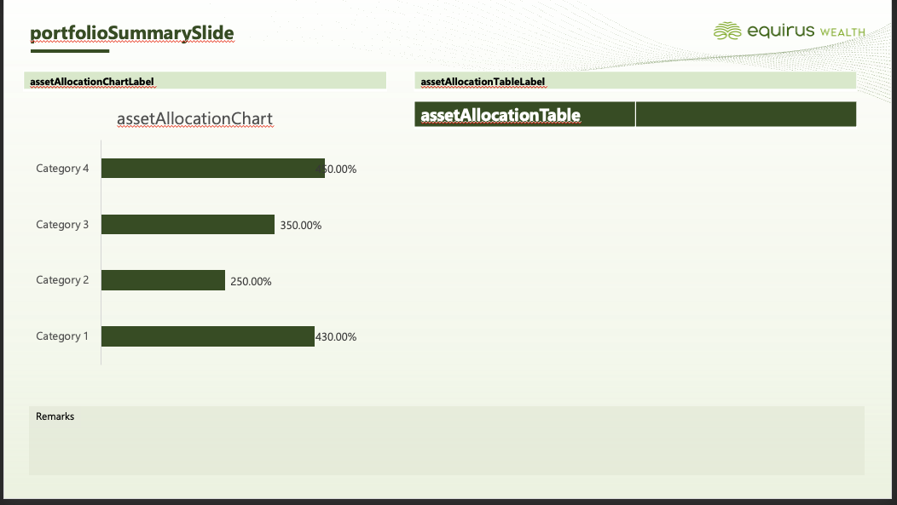
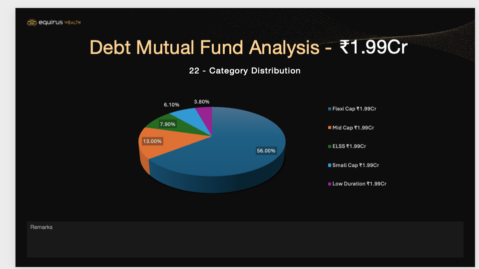
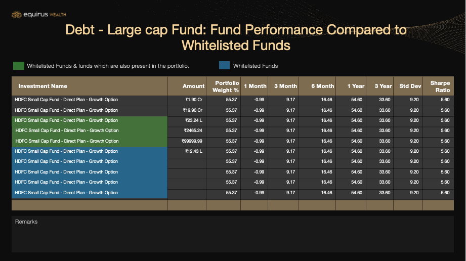

# PowerPoint Generator

### Problem Statement
As a Relationship Manager, you often need to provide clients with monthly summaries of their investments or prepare presentations for pitches. It's crucial to have a solution that can quickly generate PowerPoint presentations with accurate data sourced from CAS or other vendors. These presentations should include well-designed charts and precise numbers to effectively convey information to clients.

## Usage:
Provide JSON Input to Our Method

```kotlin
fun generatePPT() {
    val pptParametersJson = IOUtils.toString(ClassPathResource("ppt_template/pptTemplate.json").inputStream, StandardCharsets.UTF_8)
    val outputFile = PPTGenerator.generatePPT(
      outputFileName = "john_doe_prospect",
      pptParameters = JsonUtil.objectMapper.readValue(pptParametersJson, object : TypeReference<List<PowerPointParameter>>() {}),
      templateFileInputStream = this.javaClass.classLoader.getResourceAsStream("ppt_template/pptTemplate.pptx")!!
    )
    Assertions.assertThat(outputFile.lengthInMb()).isGreaterThan(7.5)
  }
```

* What are the labels?
  **_Example to put label through we fetch shapes_** 

* Example 1
<details>
<summary> Click Here to Check JSON for given example </summary>

```json
{
  "identifier": {
    "id": "userDetailsSlide"
  },
  "contents": [
    {
      "type": "TEXT",
      "text": {
        "id": "generatedDateInput",
        "data": "12 February 2025",
        "metaData": {
          "fontSize": 10.5,
          "isBold": true
        }
      }
    },
    {
      "type": "TEXT",
      "text": {
        "id": "userOrFamilyNameInput",
        "data": "John Doe Sweet Family, Random text",
        "type": "TEXT",
        "metaData": {
          "fontSize": 44,
          "textHexColor": "#538034"
        }
      }
    },
    {
      "type": "TEXT",
      "text": {
        "id": "userAccountHoldersDetails",
        "data": "John Doe (EW0001, EW0002, EW0003, EW0004), Rohn Doe (EW0005, EW0006, EW0007, EW0008), Ram (EW00010), Sohan (EW000011)",
        "type": "TEXT",
        "metaData": {
          "fontSize": 12,
          "textHexColor": "#538034"
        }
      }
    }
  ]
}
```
</details>

Output 
**_Category Distribution Slide_** 

* Example 2
<details>

<summary> Click Here to Check JSON for given example </summary>

```json
{
    "identifier": {
      "id": "portfolioSummarySlide",
      "data": "Portfolio Summary",
      "metaData": {
        "fontSize": 20,
        "inputTextAlignment": "LEFT",
        "isBold": true
      }
    },
    "contents": [
      {
        "type": "chart",
        "chart": {
          "id": "assetAllocationChart",
          "label": {
            "type": "table",
            "table": {
              "id": "assetAllocationChartLabel",
              "dataList": [
                ["Asset Allocation %"]
              ],
              "headerMetaData": {
                "backGroundColorHex": "#B5D286",
                "textMetaData": {
                  "fontSize": 11,
                  "inputTextAlignment": "LEFT",
                  "isBold": true
                }
              }
            }
          },
          "categorizedData": [
            {
              "name": "Equity",
              "values": [79.79]
            },
            {
              "name": "Debt",
              "values": [18.24]
            },
            {
              "name": "Real Estate",
              "values": [1.0]
            },
            {
              "name": "Other Assets",
              "values": [0.97]
            }
          ]
        }
      },
      {
        "type": "table",
        "table": {
          "id": "assetAllocationTable",
          "label": {
            "type": "table",
            "table": {
              "id": "assetAllocationTableLabel",
              "dataList": [
                ["Portfolio Allocation"]
              ],
              "headerMetaData": {
                "backGroundColorHex": "#B5D286",
                "textMetaData": {
                  "fontSize": 11,
                  "inputTextAlignment": "LEFT",
                  "isBold": true
                }
              }
            }
          },
          "dataList": [
            ["Holdings", "Portfolio Value"],
            ["Equity", "₹125.26 Cr"],
            ["Debt", "₹19.90 Cr"],
            ["Other Assets", "₹82.27 L"],
            ["Total", "₹156.48 Cr"]
          ],
          "headerMetaData": {
            "backGroundColorHex": "#538034",
            "textMetaData": {
              "fontSize": 10.5,
              "textHexColor": "#FFFFFF",
              "isBold": true
            }
          },
          "normalRowsMetaData": {
            "backGroundColorHex": "#E6FAC7",
            "textMetaData": {
              "fontSize": 10.5
            }
          },
          "footerMetaData": {
            "backGroundColorHex": "#738C4B",
            "textMetaData": {
              "fontSize": 10.5,
              "isBold": true
            }
          }
        }
      }
    ]
  }
```
</details>

**_Category Wise MF Analysis Slide_** 
